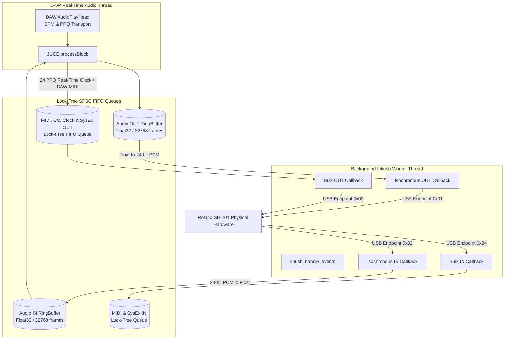

# Roland SH-201 Editor VST Architecture

Building a True Editor & Controller plugin requires bridging low-level USB hardware interrupts with a high-level, real-time DAW audio thread. This document details the step-by-step architectural design and implementation of the Roland SH-201 Editor plugin (VST3 & Standalone), enabling secure, low-latency, and crash-free communication between modern DAWs and physical synthesizer hardware.

## 1. Project Setup (CMake & JUCE)
We use **CMake** as the authoritative build system.
*   **JUCE 8 Framework**: Integrated automatically via CMake to provide the VST3/Standalone wrappers, UI components, APVTS parameter tree, and cross-platform thread primitives.
*   **Libusb-1.0**: Links against pre-compiled Windows static/dynamic libraries (`libusb-1.0.lib` / `libusb-1.0.dll`), bundling `libusb-1.0.dll` alongside the built plugin binaries.
*   **Composite Device Support**: Automatically claims both Standard Mode (`0x00AD`, MIDI-only) and Advanced Mode (`0x00B3`, MIDI + Isochronous Audio) product IDs.

## 2. The Threading Model & Lock-Free Concurrency
The most critical rule of VST development is **never block the real-time audio thread**. USB I/O is inherently blocking or callback-driven; calling kernel USB APIs or holding mutexes inside `processBlock()` will cause audio dropouts or Windows kernel bugchecks (`DPC_WATCHDOG_VIOLATION` BSOD).

### Key Concurrency Principles:
*   **Lock-Free MIDI Output FIFO (`midiOutFifo`)**: All outbound MIDI Note, Control Change, Program Change, Real-Time Clock (`0xF8`), and SysEx packets generated by `processBlock()` or APVTS parameter changes are pushed into a lock-free Single-Producer Single-Consumer (SPSC) queue. The background `SH201_LibUSB_Thread` pops messages asynchronously and performs bulk USB transfers.
*   **Safe Lifetime Management**: Asynchronous GUI repaints and parameter notifications posted to the message thread via `juce::MessageManager::callAsync` use `juce::WeakReference<SH201AudioProcessor>` to guarantee safe execution if the plugin instance is unloaded or the project is closed.

## 3. Isochronous Audio Streaming
USB Isochronous transfers require an uninterrupted stream of packets to prevent audio glitching.
*   **Packet Size**: `288 bytes` maximum per frame (44.1 kHz, 24-bit stereo PCM data).
*   **Transfer Pool**: A pool of 4 concurrent `libusb_transfer` structs (8 packets per transfer) is submitted simultaneously.
*   **Conversion & Resampling**:
    *   When an Isochronous IN transfer completes, the libusb callback converts 24-bit Little-Endian PCM data into normalized 32-bit floats (`[-1.0f, 1.0f]`) and pushes them into `AudioInQ` (`juce::AbstractFifo`, 32,768 frames ~0.74s capacity).
    *   Because the SH-201 operates at a fixed 44.1 kHz sample rate, if the DAW operates at 48 kHz or 96 kHz, `processBlock()` uses `juce::LagrangeInterpolator` for dynamic real-time resampling.
*   **Graceful Fallback**: If audio interfaces cannot be claimed (e.g., WinUSB driver installed only for Interface 2 in Standard MIDI Mode), the plugin operates cleanly in **MIDI/SysEx-Only Mode** without crashing.

## 4. Bulk MIDI, SysEx & Real-Time Clock Protocol
*   **4-Byte USB-MIDI Packets**: Bulk endpoints `0x03` (OUT) and `0x84` (IN) handle USB-MIDI packets (1 header byte + 3 MIDI bytes).
*   **Cable Index Number (CIN) Routing**:
    *   `CIN = 0x09..0x0E`: Standard Note, CC, Pitch Bend, and Program Change messages.
    *   `CIN = 0x04 / 0x07`: SysEx DT1/RQ1 packets (`0xF0 41 10 ... 0xF7`).
    *   `CIN = 0x0F`: System Real-Time messages (`0xF8` MIDI Clock, `0xFA` Start, `0xFC` Stop, `0xFE` Active Sensing).
*   **Multi-Layer 111-Parameter SysEx Address Map**:
    *   **Patch Common (`10 00 00 xx`)**: 15 parameters including Keyboard Mode (Single/Dual/Split), Split Point, Tone Balance, Voice Mono/Solo, Portamento, Reverb & Delay Level/Switch.
    *   **Upper Tone (`10 00 01 xx`)**: 48 parameters prefixed with `upper_`.
    *   **Lower Tone (`10 00 02 xx`)**: 48 parameters prefixed with `lower_`.
    *   **System Common (`01 00 00 xx`)**: System Clock Source (`01 00 00 0B`) and System Tempo (`01 00 00 0C..0E`).
*   **Multi-Byte Nibble Encoding**: Multi-byte values such as Patch Tempo and System Tempo (5–300 BPM) are split across three consecutive address nibbles (`0x0E..0x10` for Patch, `0x0C..0x0E` for System) with authoritative checksum generation (`(128 - (sum % 128)) % 128`).

## 5. DAW Tempo Synchronization & Playhead Engine
The plugin provides complete synchronization between DAW project tempo and the physical synthesizer:
*   **USB Clock Mode (`24 PPQ Real-Time Clock Generation`)**:
    *   When the hardware SH-201 `System Clock Source` is set to `USB`, `processBlock()` evaluates the DAW's `AudioPlayHead` position and transport state.
    *   When playback starts, it sends MIDI Start (`0xFA`). While playing, it computes the exact integer quarter-note pulse index across variable audio buffer sizes and queues `0xF8` MIDI Clock pulses at exactly 24 PPQ, driving the hardware arpeggiator, LFO, and delay tempo without drift or jitter.
*   **PATCH & SYSTEM Clock Mode (`SysEx BPM Sync`)**:
    *   When DAW BPM changes (e.g., from 120 to 128 BPM), the plugin detects the delta and asynchronously transmits DT1 SysEx commands updating `common_patch_tempo` (`10 00 00 0E..10`) and `system_tempo` (`01 00 00 0C..0E`).

## 6. Total State Save & Recall
Because all 111 parameters are managed by JUCE APVTS, the DAW automatically stores the complete synthesizer state inside the DAW project `.cpr` / `.als` / `.rpp` session file.
*   **Project Recall (`setStateInformation`)**:
    *   On load, APVTS parameters are restored using unnormalized raw parameter values (`apvts.getRawParameterValue(id)->load()`).
    *   UI repaints are notified immediately, while an asynchronous background thread (`syncAllParametersToHardware()`) transmits the parameters to the SH-201 hardware at 2ms intervals, preventing audio thread stalling.
*   **Live Hardware Pull (`requestPatchMemory`)**:
    *   Clicking `[PULL SYNTH]` issues three sequential `RQ1` SysEx dump requests (`10 00 00 00`, `10 00 01 00`, `10 00 02 00`) and parses the hardware's DT1 responses into APVTS without flooding GUI repaint queues.

## 7. Implementation Phases & Architecture Roadmap

### Phase 1: CMake & Libusb Boilerplate [COMPLETED]
*   Created JUCE 8 VST3/Standalone CMake target with embedded static `libusb-1.0` library and Windows SDK linking.

### Phase 2: The USB Connection Manager [COMPLETED]
*   Configured background `SH201_LibUSB_Thread` supporting automatic interface claiming across both Standard (`0x00AD`) and Advanced (`0x00B3`) USB PID modes.

### Phase 3: SysEx & MIDI Bulk Architecture [COMPLETED]
*   Implemented bidirectional CC and SysEx parameter synchronization audited against official Roland MIDI implementation charts.
*   Expanded from a single tone table to a comprehensive **111-Parameter Multi-Layer Architecture** (Common, Upper Tone, Lower Tone).
*   Added `std::atomic<bool> isUpdatingFromHardware` loop guards to prevent feedback loops between synth knobs and VST UI.

### Phase 4: Audio Streaming (Isochronous) [COMPLETED]
*   Universal USB Audio IN (`0x82`, Interface 1, Alt 1) capturing 8-packet Isochronous transfers (4 concurrent pool transfers, `288 bytes` max per frame) of 24-bit stereo PCM at 44.1 kHz.
*   Implemented `processBlock()` DAW-to-Hardware MIDI forwarding over USB Bulk OUT (`0x03`).
*   Lock-Free SPSC FIFO (`juce::AbstractFifo`, size `32768` stereo frames ~0.74s capacity) decoupling USB interrupts from DAW audio callbacks.

### Phase 5: Total State Save & Recall & UI Control Surface [COMPLETED]
*   111-Parameter Control Surface with interactive `[UPPER TONE PAGE]` and `[LOWER TONE PAGE]` switching (`10 00 00 12 <00/01>`).
*   **Stereo Mode & Dual-Tone Mirroring**:
    *   `[STEREO MODE]` latched button (`common_stereo_mode`) copying Upper Tone parameters to Lower Tone and setting Keyboard Mode to `DUAL` (`10 00 00 00`).
    *   `[WIDTH]` knob (`common_stereo_width`) controlling stereo spread (`0%` center to `100%` hard-panned L/R).
    *   `[PARAM LINK]` mode (`LINK ALL` vs `EXCLUDE OSC`) allowing independent oscillator detuning across stereo channels.
*   **CC Mapping Alignment & 250ms SysEx Echo Suppression**:
    *   Mapped incoming physical knob CCs to official Roland Owner's Manual specifications (p. 72) with secondary CC fallbacks.
    *   Implemented 250ms timestamp echo suppression (`lastHardwareRxTime[paramId]`) in `sendParameterChangeToHardware()`, preventing feedback loops when turning physical synth knobs.
*   **Bijective Oscillator Pitch Range Scaling (`NormalisableRange`)**:
    *   Dynamic slider scaling between Normal mode (`-12..+12` semitones) and Wide mode (`-36..+36` semitones) using custom `juce::NormalisableRange<double>` mapping directly to APVTS's fixed `[-36, 36]` range, preventing scaling errors or detuning when copying tones in Stereo Mode.
*   **Modern Premium Glassmorphism UI**: Dark slate/charcoal aesthetics (`#11141a` / `#161a22`) with glowing neon cyan accents (`#00e5ff`) and uniform `54x66 px` rotary knob layout.

### Phase 6: Advanced Parameter Panels & CallOutBox UIs [COMPLETED]
*   Added 28 Patch Common & System parameters to APVTS (`master_tune`, `system_tempo`, `patch_rx_tx_channel`, etc.).
*   Implemented interactive `juce::CallOutBox` overlay (`AdvancedPatchCommonComponent`) for quick access to Master Tune, System Clock, Metronome, and MIDI routing.

### Phase 7: Comprehensive Patch Browser & Syx Library Integration [COMPLETED]
*   **Patch Browser Overlay (`PatchBrowserComponent`)**: Interactive preset browser supporting `.syx` patch libraries, category filtering (Bass, Lead, Pad, Poly, Arp, FX, User), and direct patch loading into temporary memory or physical hardware user banks.
*   **Binary Patch Serializer (`SH201PatchSerializer`)**: Full SysEx parser/generator that packs and unpacks complete SH-201 patch dumps (`10 00 00/01/02 xx`) to/from standard `.syx` files with checksum verification and ASCII patch name extraction.
*   **Automatic Stereo Mode Normalization on Patch Export**: Before exporting a patch to `.syx`, the serializer automatically checks if Stereo Mode is active and toggles it off, resetting amp pans to center (`0`) and keyboard mode to `SINGLE` so exported presets remain center-panned and compatible.

### Phase 8: DAW Tempo Synchronization & Real-Time USB MIDI Clock [COMPLETED]
*   **USB-MIDI Real-Time CIN Mapping (`SH201USBManager`)**: Compliant with USB MIDI 1.0 Spec Table 4-1 using CIN `0x05` for single-byte System Real-Time messages (`0xF8` Clock, `0xFA` Start, `0xFC` Stop), enabling hardware tempo lock over USB.
*   **DAW Playhead Clock Engine (`syncHostTempoAndClock`)**:
    *   Real-time 24 PPQ MIDI Clock (`0xF8`) pulse generator in `processBlock()` for **USB Clock Mode**.
    *   Asynchronous multi-byte DT1 SysEx tempo synchronization (5–300 BPM) for **PATCH** and **SYSTEM Clock Mode**.
*   **System Common Support**: Added `system_clock_source` (`01 00 00 0B`) and `system_tempo` (`01 00 00 0C..0E`) parameter transmission and incoming SysEx parsing.

### Phase 9: Lock-Free Concurrency & DPC Watchdog BSOD Elimination [COMPLETED]
*   **Real-Time Lock-Free MIDI FIFO (`midiOutFifo`)**: Migrated all MIDI/SysEx transmission out of the audio thread into an asynchronous lock-free queue, eliminating kernel mutex blocking and `DPC_WATCHDOG_VIOLATION` BSODs.
*   **Safe WeakReference Async Execution**: All asynchronous GUI repaints and APVTS callbacks use `juce::WeakReference<SH201AudioProcessor>`, guaranteeing crash-free execution during DAW project teardown or plugin unloading.

### Phase 10: Complete Patch Serialization (Delay & Reverb Multi-Packet SysEx) [COMPLETED]
*   **5-Packet Complete Patch Export (`SH201PatchSerializer::exportPatchToFile`)**:
    *   Generates and exports all five required SH-201 DT1 SysEx packets when saving presets to `.syx` files:
        1. **Patch Common (`10 00 00 00`)**: Keyboard mode, Tone balance, Delay switch, Reverb switch, Split point, etc.
        2. **Tone 1 - Upper (`10 00 01 00`)**: Complete 64-byte Upper Tone memory including Delay Level (`0x25`), Reverb Level (`0x26`), Pitch Bend Range, Octave Shift, and Portamento parameters.
        3. **Tone 2 - Lower (`10 00 02 00`)**: Complete 64-byte Lower Tone memory including effect send levels and performance controls.
        4. **Patch Delay (`10 00 03 00`)**: Delay time, feedback, HF damp choice, mod rate, and mod depth (`0x00..0x04`).
        5. **Patch Reverb (`10 00 04 00`)**: Reverb time, pre-delay, size, high cut, density, diffusion, LF/HF damp frequency and gain (`0x00..0x09`).
*   **Multi-Packet SysEx Parser & Loader (`SH201PatchSerializer::loadPatchIntoTone`)**:
    *   Upgraded `loadPatchIntoTone` to iterate through and load every DT1 packet present in a `.syx` file (`addr2 <= 0x04`), updating APVTS parameters and transmitting full preset dumps to the hardware synthesizer.

### Phase 11: Preset Loading Silence Fix, Hardware SysEx Pacing & Reliable Stereo Mode [COMPLETED]
*   **Paced Bulk Preset Loading & Silence Prevention**:
    *   Preset loading (`SH201PatchSerializer::loadPatchIntoTone`) marks all loaded parameters as updated from hardware (`markParameterUpdatedFromHardware`) to eliminate 135 redundant APVTS echo SysEx packets that previously overwhelmed the SH-201 hardware DSP and caused audio silence.
    *   `createCommonDT1Packet` guarantees sensible defaults for `common_patch_level` (`127`) and `common_tone_balance` (`64`), ensuring exported presets never load silent.
*   **500ms Hardware Echo Suppression Window**: Extended `sendParameterChangeToHardware()` suppression window (`lastHardwareRxTime[paramId]`) from 250ms to 500ms to debounce hardware echoes during patch loading and preset switching.
*   **100% Reliable Stereo Mode Controls**: All Stereo Mode activation/deactivation steps (`activateStereoMode`, `deactivateStereoMode`, `applyStereoWidth`) explicitly tag APVTS parameter changes with `markParameterUpdatedFromHardware` and space out bulk tone DT1 commands using message-thread timers (`juce::Timer::callAfterDelay`), ensuring tone panning, keyboard mode (`SINGLE`/`DUAL`), and stereo width mirroring always apply reliably without dropping packets.
*   **Automatic Stereo Mode Deactivation on Export**: Before exporting a patch to `.syx`, `exportPatchToFile` automatically deactivates Stereo Mode (`deactivateStereoMode()`), resetting tone pans to center (`0`) and keyboard mode to `SINGLE` before generating the `.syx` file.

### Phase 12: Robust Project State Loading & Delay Syncing [COMPLETED]
*   **Fully Tracked Parameter Tree**: Explicitly initialize `apvts.state` to ensure the value tree automatically stores default parameter values. This solves an issue where unchanged UI controls weren't saved in the `.cpr` / `.als` session file.
*   **Safe Sync Delay & Conflict Mitigation**: Implemented a 3000ms delay in `syncAllParametersToHardware()` upon project load and suppressed concurrent start-up dumps by correctly managing `hasLoadedDAWProjectState` and aborting `isSyncingFromHardware` to eliminate SysEx overwriting conflicts during long DAW session loads.
*   **Unrequested Bulk Dump Filtering**: `handleIncomingSysEx` now explicitly filters out and ignores any bulk parameter dumps (payload size > 4 bytes) unless `isSyncingFromHardware` is true, acting as a final safeguard against delayed hardware dumps corrupting DAW session state.

### Phase 13: Persistent GUI Size [COMPLETED]
*   **APVTS State Retention**: Modifying the VST window dimension dynamically triggers a save to the `apvts.state` ValueTree (`ui_width` and `ui_height` properties) in `SH201AudioProcessorEditor::resized()`.
*   **Automatic Layout Restoration**: When the `SH201AudioProcessorEditor` constructor is called during a project load or initialization, it automatically reads the custom properties from the `AudioProcessorValueTreeState` and restores the plugin's affine transform scaling using `setSize(w, h)`.

### Phase 14: Patch Sync Refinements & UI Polish [COMPLETED]
- **INIT PATCH Synchronization:** Updated the `INIT PATCH` logic to automatically set the `isSyncingFromHardware` flag and request a memory dump (`requestPatchMemory()`) immediately after sending the initialization SysEx. This ensures the VST GUI perfectly mirrors the synth's initialized state without requiring the user to manually click "PULL SYNTH".
- **Oscillator Labels:** Renamed VST GUI labels in the Oscillator 1 & 2 sections to match the physical SH-201 hardware labels:
  - `Osc 1 Fine Tune` changed to `DETUNE`
  - `Osc 1 Pulse Width` and `Osc 2 Pulse Width` changed to `PW/FEEDBK`

### Phase 15: GUI Persistence Fixes [COMPLETED]
- **Global Settings for GUI Size:** The plugin now manages its window size (`gui_width` and `gui_height`) using a global JUCE `PropertiesFile` (`Transfict8 Audio Tools/SH201Editor.xml`) rather than embedding the size into individual DAW project's `AudioProcessorValueTreeState`. This completely separates the visual preferences from the audio state, meaning resizing the plugin persists globally across all projects without needing to save the DAW project.
- **GUI Size Dropdown:** Added a `setupStandaloneCombo` function to `SystemSettingsComponent` to support combo boxes not bound to audio parameters. Added a "GUI Size" combo box in the SYSTEM SETTINGS panel with snap options (75%, 100%, 125%, 150%, 200%, Custom) that dynamically updates the editor window size and global settings.

### Phase 16: Independent Panel Parameter Linking [COMPLETED]
- **Panel Linking**: Added 10 new independent latchable `LINK` buttons (`link_osc1`, `link_osc2`, `link_mix_mod`, `link_pitch_env`, `link_filter`, `link_filter_env`, `link_amp`, `link_amp_env`, `link_lfo1`, `link_lfo2`) to the top-right corner of each sound design panel across the UI.
- **Synchronization Mechanics**: Toggling a link ON triggers a one-way sync (`handleLinkModeParameterChange`), copying the current panel's values from the active Tone Page to the opposite Tone Page. While the link remains active, future parameter adjustments to that panel are continuously mirrored across both Tones.
- **State Retention & SysEx Separation**: Link toggle states are fully backed by standard APVTS boolean parameters (`addChoiceParam("link_...", { "OFF", "ON" })`), ensuring they save perfectly within the DAW's VST project state. Because they do not map to SH-201 hardware SysEx addresses, they are automatically excluded from hardware transmission (`sendParameterChangeToHardware`), keeping the synth hardware safe from unknown parameters.

### Phase 17: Editor Mode and USB Audio Streaming Toggle [COMPLETED]
- **Editor Mode Dropdown**: Added an `Editor Mode` dropdown to the System Settings window with two options: `MIDI + Audio` and `MIDI only`.
- **USB Audio Streaming Toggle**: Implemented the `MIDI only` mode by bypassing the USB audio interface claiming during USB initialization (`tryConnect()`), effectively stopping USB audio streaming to save USB bandwidth while maintaining MIDI control.
- **Green Status Indicator**: Updated the dynamic status label logic to cleanly display `MIDI + Audio` or `MIDI Only` depending on the active mode, providing visual confirmation of the audio disconnect.
- **Persistence**: Used `GlobalSettings` to persist the chosen Editor Mode in the global configuration file so the VST remembers the user's preference between sessions.

### Phase 18: Standard MIDI File (.mid) Patch Export & Import [COMPLETED]
- **MIDI File Export**: Switched patch exporting from raw `.syx` bytes to Standard MIDI Files (`.mid`) using `juce::MidiFile`. Multi-packet SysEx patch memory dumps are now encapsulated as sequenced `juce::MidiMessage` events with calculated delta times. This prevents MIDI buffer underruns and allows patches to be dragged directly into DAWs for hardware playback without requiring the VST.
- **Dual-Format Import Compatibility**: Enhanced `SH201PatchSerializer::loadPatchIntoTone` to dynamically parse incoming patch files based on extension. It seamlessly extracts SysEx tracks from new `.mid` exports while retaining fallback logic to natively read legacy `.syx` binaries, ensuring users retain access to all historically created soundbanks.

### Phase 19: MIDI Loop Prevention & Patch SysEx Conflict Resolution [COMPLETED]
- **Stereo Mode MIDI Loop Fix**: Fixed a critical crash caused by a MIDI feedback loop when adjusting hardware parameters (e.g., filter cutoff) while Stereo Mode was active. Implemented `lastHardwareRxTime` and `isUpdatingFromHardware` locks in `handleIncomingMidiCC` and `handleIncomingSysEx` to prevent the VST from re-transmitting parameter updates back to the hardware immediately after receiving them.
- **Patch SysEx Conflict Resolution**: Fixed parameter jumps and `.mid` patch export corruption caused by conflicts between Upper and Lower tone blocks in third-party patches. `SH201PatchSerializer` now explicitly filters out redundant common-in-tone parameters (like Delay/Reverb levels, Portamento, Mono/Solo) from the Lower tone block, ensuring the Upper tone's values remain authoritative. Added missing `pitch_wide` scaling (`*3`/`/3`) and `common_tone_balance` negation to the patch serializer's load and export paths to guarantee encoding consistency with live hardware transmission.

### Phase 20: DIN MIDI Hardware Control & Dynamic Port Selection [COMPLETED]
- **Unified Hardware Routing Subsystem**: Added `SH201DinMidiManager` alongside `SH201USBManager` behind an abstracted routing layer in `SH201AudioProcessor` (`sendSysExToHardware`, `sendMidiCCToHardware`, `sendMidiMessageToHardware`, `queueMidiMessageToHardware`, `requestPatchMemoryFromHardware`, `isHardwareConnected`, `getHardwareConnectionStatus`).
- **DIN MIDI Mode Support**: Extended `Editor Mode` in System Settings to include `DIN MIDI` (mode 2). In this mode, libusb claiming and USB audio streaming are bypassed entirely, enabling hardware control over standard 5-pin DIN MIDI cables without requiring USB driver installation.
- **Dynamic Port Selection**: Added `MIDI In Port` and `MIDI Out Port` comboboxes in `SystemSettingsComponent` that dynamically enumerate system MIDI devices using `juce::MidiInput::getAvailableDevices()` and `juce::MidiOutput::getAvailableDevices()`. The port selectors appear whenever `DIN MIDI` mode is selected and persist their chosen device identifiers/names in `SH201Editor.xml`.
- **Thread-Safe Lock-Free DIN MIDI Queue**: Implemented a 1024-packet lock-free FIFO queue (`midiOutFifo`) and high-priority background worker thread in `SH201DinMidiManager` to handle DAW notes, control changes, and clock sync from `processBlock()` in a completely real-time safe manner.
- **Robust Error Handling & Loopback Safety**: Implemented graceful error recovery for disconnected or misconfigured MIDI ports without crashes, along with hardware echo suppression via `lastHardwareRxTime` to prevent MIDI feedback loops when using external MIDI interfaces.

### Phase 21: DIN MIDI Data Routing & UX Fixes [COMPLETED]
- **Throttle Loop Fix**: Fixed a bug where `timerCallback()` was improperly updating `lastHardwareTxTime` before calling `sendParameterChangeToHardware()`, causing the parameter transmission check to always see 0ms elapsed and continuously defer parameter changes into `pendingHardwareUpdates`, thus freezing all DIN MIDI SysEx outputs.
- **Connection Status Reliability**: Updated `SH201DinMidiManager::isConnected()` to strictly require both `midiInput != nullptr` and `midiOutput != nullptr`. This prevents the VST UI from falsely reporting "CONNECTED" when the output port fails to open (e.g., due to Windows single-client DAW locking).
- **Fallback Name Matching**: Modified `reinitializeHardwareConnection()` to pass both the saved device `identifier` and `name` to `openDevices()`. If the Windows OS re-enumerates the USB device and changes the identifier, the plugin seamlessly reconnects using the string name as a fallback.
- **FIFO Wrap-around Drop Fix**: Corrected an edge-case in `SH201DinMidiManager::queueMidiMessage()` to properly handle `block2` when the JUCE `AbstractFifo` ring buffer write pointer wraps around, preventing every 1024th real-time MIDI clock/note message from dropping.
- **Slower Baud Rate Handshaking**: Increased the `isSyncingFromHardware` fallback timeout from 500ms to 2000ms dynamically when DIN MIDI is selected, ensuring the VST UI doesn't prematurely timeout waiting for `RQ1` bulk dumps over slower 31.25 kBaud standard MIDI links.
- **Stereo Mode SysEx Routing**: Re-routed Stereo Mode initialization SysEx packets through the abstracted `sendSysExToHardware()` pipeline, fixing an issue where they bypassed DIN mode entirely by directly invoking the `SH201USBManager`.
- **Editor Mode Naming**: Renamed the UI combo box labels to "USB MIDI + Audio", "USB MIDI Only", and "DIN MIDI" to prevent UX confusion, widening the bounds by 30px to accommodate the text.

### Phase 22: Hardware Knob Support in Stereo & Linked Modes + DAW Crash & Loop Elimination [COMPLETED]
- **DAW Host Automation Thread-Safety**: Resolved DAW host crashes (e.g. Ableton, FL Studio, Reaper, Cubase) when physical knobs were adjusted by ensuring parameter notifications (`param->setValueNotifyingHost`) are strictly executed on the JUCE Message Thread via `juce::MessageManager::callAsync`, eliminating illegal concurrent cross-thread calls from libusb and MIDI driver threads.
- **Libusb Re-entrancy & Deadlock Elimination**: Removed the mirror-bypass check `&& !isUpdatingStereoMirror.load()` in `sendParameterChangeToHardware()`. While actively processing incoming hardware edits (`isUpdatingFromHardware == true`), outgoing parameter transmissions are fully suppressed, completely preventing synchronous `libusb_bulk_transfer()` calls from executing within the libusb transfer completion callback (`bulkInCallback`).
- **Bidirectional SysEx Echo Suppression**: Added timestamp-based echo suppression (`lastHardwareTxTime`, 500ms window) in `handleIncomingSysEx()` matching `handleIncomingMidiCC()`, eliminating recursive ping-pong loops when the Roland SH-201 hardware echoes parameter edits via "Transmit Edit Data" SysEx DT1 messages.
- **DAW Track MIDI Thru CC Echo Filtering**: Filtered out all front-panel synthesizer sound edit CCs in `processBlock()` before queuing them to the hardware, preventing DAW tracks with active MIDI monitoring from reflecting knob turn CCs back to the hardware engine.
- **Debounced Mirrored Hardware Synchronization**: Mirrored and linked parameter changes originating from physical hardware tweaks are accumulated in `pendingMirroredHardwareUpdates` and debounced (120ms threshold). Once the user finishes moving the knob, a single clean SysEx DT1 packet is transmitted on the JUCE Message Thread to bring the opposite tone on the hardware synth into 100% sync without saturating the synth CPU or MIDI buffer.
- **Stereo Status Readout**: Enhanced header `LAST HW RX` readout to indicate `[STEREO MIRROR]` in real-time when hardware knobs are turned while Stereo Mode is active.
